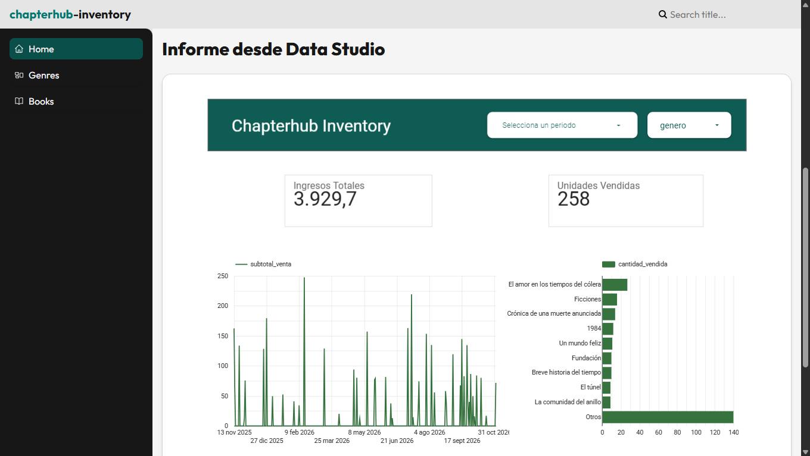
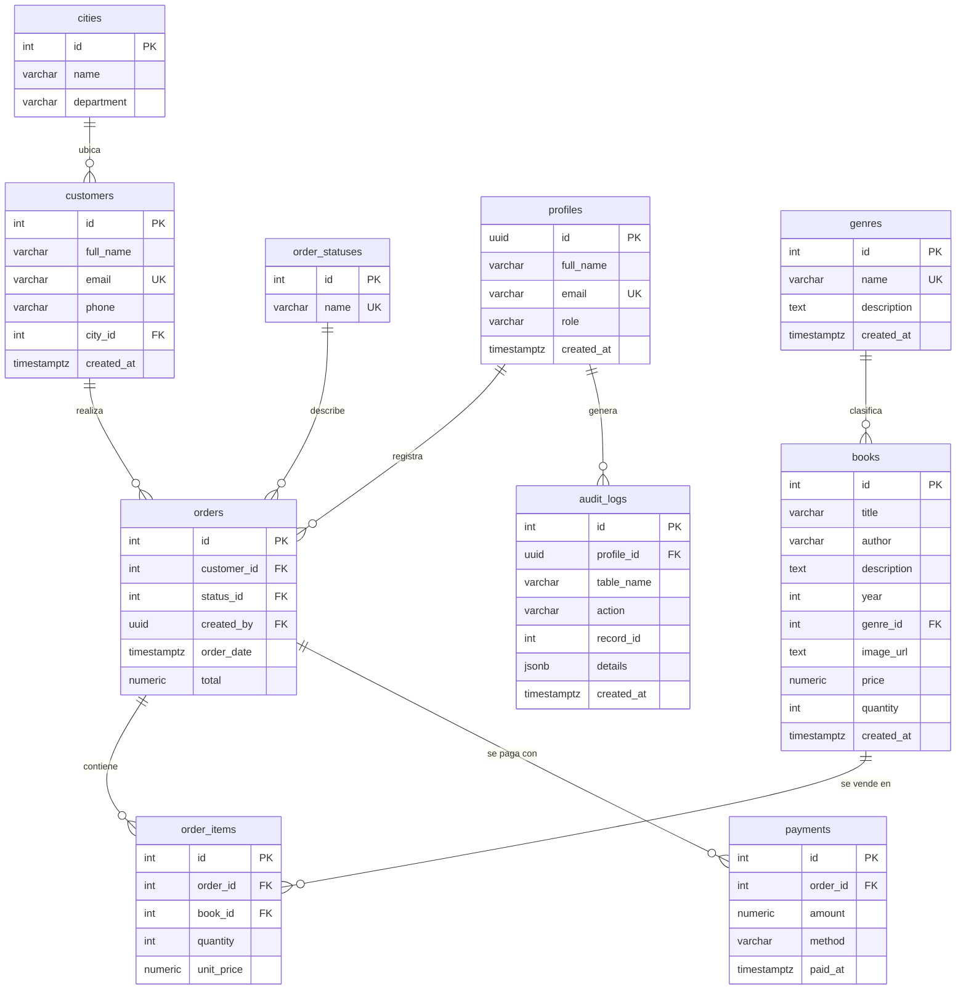

# ChapterHub Inventory

A full-stack **Express + PostgreSQL (Supabase)** bookstore inventory application featuring **CRUD**, **image uploads**, **search**, **sorting**, **filtering**, and clean server-rendered views using **EJS + Tailwind CSS**.

Audited and extended to an enterprise **10-table relational model** hosted on **Supabase** with business analytics embedded from **Google Looker Studio**.

---

## Tech Stack & Tools


---

## Screenshots

### Home Page


### Analytics Dashboard


### Books Page


### Edit Book Page


### Delete Genre Page


### Error Page


> Go to Live demo Section to see more pages - Error 500 Page, Edit Genre Page , Delete Book Page

---

# Features

### Books Management

- Create, edit, delete books
- Upload cover images (Multer)
- Metadata support: title, author, year, description
- Additional fields: **price**, **quantity**
- Filename hashing using crypto
- Full validation with express-validator

### Genres Management

- Create, edit, delete genres
- Name + description fields
- Prevent duplicates using DB constraints
- Genre dropdown in book forms

### Search, Filter & Sort

- Search books by title
- Filter books by **one or multiple genres**
- Sort options:
  - Title (A–Z / Z–A)
  - Year (Oldest / Newest)
  - Price (Low → High / High → Low)

### Database Layer

- PostgreSQL hosted on **Supabase** (Session Pooler IPv4)
- Normalized 10-table schema supporting sales, customers, orders, and audit logs
- Embedded interactive BI Dashboard from **Google Looker Studio**
- Parameterized SQL queries (SQL injection safe)

### UI (Tailwind + EJS)

- Tailwind CSS v4
- Modern, minimal, responsive UI
- Clean EJS templates

---

# Folder Structure

```
chapterhub-inventory/
│
├─ app.js
├─ package.json
├─ nodemon.json
│
├─ db/
│   ├─ seed.js
│   ├─ pool.js
│   ├─ data/
│   │    ├─ books.js
│   │    └─ genres.js
│   └─ queries/
│        ├─ books.js
│        └─ genres.js
│
├─ controllers/
│   ├─ booksController.js
│   └─ genresController.js
│
├─ routes/
│   ├─ booksRouter.js
│   ├─ genresRouter.js
│   └─ indexRouter.js
│
├─ validators/
│   ├─ booksValidators.js
│   └─ genresValidators.js
│
├─ middlewares/
│   ├─ upload.js
│   └─ setLocals.js
│
├─ views/
│
└─ public/

```

---

# Database Schema

The original schema (2 tables: `books`, `genres`) was audited and extended to a **10-table relational model** with explicit primary and foreign keys, referential integrity constraints, and indexes.

### Diagrama Entidad-Relación (DER)



# Scripts SQL de Creación y Población
Los scripts oficiales para inicializar el esquema completo y los datos asimétricos se encuentran en la raíz del repositorio:
- Script de Creación de Tablas, Llaves e Índices: 01_schema.sql
- Script de Población de Datos Iniciales (Seed): 02_seed.sql
---

# Setup & Installation

### 1. Clone the repository

```bash
git clone https://github.com/Jaramillo-Caleb/chapterhub-inventory.git
cd chapterhub-inventory
```

### 2. Install dependencies

```bash
pnpm install
```

### 3. Create `.env`

```
DATABASE_URL=conexion_adjunta_en_el_classroom
PORT=3000
```

### 4. Seed the database

Fresh reset:

```bash
pnpm seed:reset
```

Normal seed:

```bash
pnpm seed
```

---

# Running the Project

### Development mode (server + Tailwind watcher)

```bash
pnpm dev
```

### Build Tailwind for production

```bash
pnpm css:build
```

### Start server normally

```
pnpm start
```

Server runs at:

```
http://localhost:3000
```

---

# Image Upload System

- Uploads stored in: `public/uploads/`
- Uses Multer disk storage
- Accepts: `.jpg`, `.jpeg`, `.png`, `.webp`
- Max file size: **5MB**
- Unique filenames using `crypto.randomBytes`

---

# Author

**Sameer Ali**  
Full-stack developer & Odin Project learner.

---

# License

**MIT License** — free to modify & share.

---

# Citations

https://github.com/devxsameer/chapterhub-inventory
